 

---

### 📰 À propos

Développeur logiciel, **diplômé d'un Mastère Expert en Développement logiciel, mobile et IoT** (Ynov Campus Bordeaux). 
En dehors du boulot, j'automatise tout ce qui peut l'être : homelab auto-hébergé, bots, CI/CD, 
et contributions à l'émulation PS5 (16 PR mergées sur AnyPS5).

---

### 🧩 Ce sur quoi je bosse

- 🍄 **Modding Nintendo** : un mod coop local 2 à 4 joueurs pour Super Mario Galaxy (en C++ sur la décompilation Petari), et un portage natif de Wii Play: Tanks!
- 🎮 **Émulation PS5 → PC** : contributions C++ à [AnyPS5](https://github.com/boykopovar/AnyPS5) (traduction de shaders, pilote graphique AGC, modules audio Ngs2, librairies système HLE, perfs)
- 🏠 **Homelab Proxmox** : conteneurs LXC, stack média Podman (Jellyfin, Sonarr, Shoko…), AdGuard, VPN Tailscale, scripts d'automatisation Python
- 🤖 **Bots & automatisation** : rotation automatique de serveurs Minecraft avec auto-récupération des crashs, bot Discord de relais chat/stats déployé sur Render
- 🧠 **Dev assisté par IA** : workflows multi-agents (Claude Code, Gemini), mémoire partagée auto-hébergée entre mes machines

---

### 🛠️ Compétences

**Langages**

**Web / Mobile**

**DevOps / Infra**

---

### 🚀 Projets

| Projet | Description |
|--------|-------------|
| **Super Mario Galaxy — Local Co-op** *(repo privé)* | Mod coop 2 à 4 joueurs sur le même écran, façon 3D World : caméra de groupe, bulles, un Mario complet par joueur |
| [**AnyPS5**](https://github.com/boykopovar/AnyPS5/pulls?q=author%3AEdouardSence+is%3Amerged) | 16 PR mergées sur l'outil de portage automatique d'exécutables PS5 vers Linux/Windows |
| [**WiiPlayNative**](https://github.com/Poop-Agency/WiiPlayNative) | Portage natif C++20 de Wii Play: Tanks! : chargement des 100 missions d'origine, rendu Raylib, multijoueur en ligne ENet |
| [**Tanks!**](https://github.com/Poop-Agency/wiiPlayTanks) | Version web de Tanks! jouable en coop en ligne de 2 à 4 joueurs : [**jouer**](https://wii-play-tanks.vercel.app) |
| [**boxtoplay-dashboard**](https://github.com/Poop-Agency/boxtoplay-dashboard) | Rotation automatique de serveurs Minecraft : dashboard TanStack Start sur Vercel, worker de scraping des modpacks, bot Discord de relais chat/stats |
| [**ratiomaster-cli**](https://github.com/EdouardSence/ratiomaster-cli) | Portage CLI de RatioMaster.NET : simulateur d'annonces tracker BitTorrent |
| [**Timeless-Heroes**](https://github.com/EdouardSence/Timeless-Heroes) | Jeu idle sur le thème du dev : backend NestJS en microservices (Redis, BullMQ, NATS, PostgreSQL, JWT, anti-triche), apps Electron et Next.js |
| [**MOONGO**](https://github.com/EdouardSence/MOONGO) | App mobile Flutter avec Firestore : collection de créatures, calendrier de tâches, thèmes, golden tests |

---

### 🏆 Trophées GitHub

---

### 🔥 Statistiques GitHub

<picture>
  <source media="(prefers-color-scheme: dark)" srcset="./profile/snake-dark.svg" />
  <source media="(prefers-color-scheme: light)" srcset="./profile/snake.svg" />
  
</picture>

